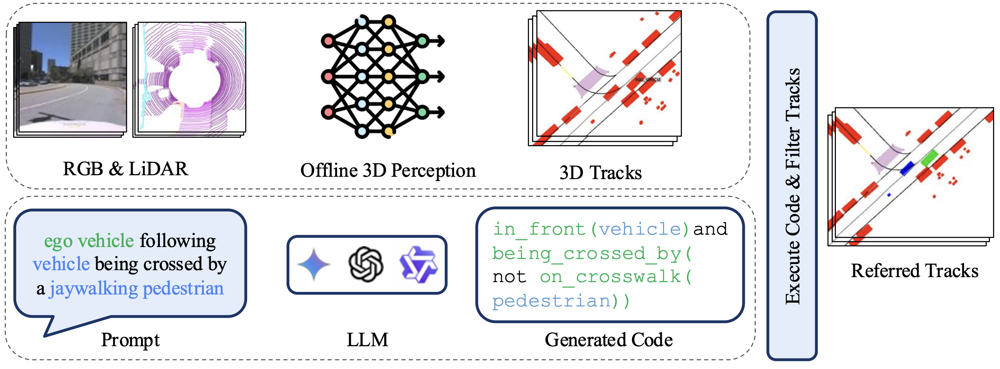

<h2 align="center">RefAV: Towards Planning-Centric Scenario Mining</h2>

<p align="center"><b>CVPR 2026 Oral</b></p>

<!-- Link to a paper -->
<p align="center">
  <a href="https://arxiv.org/abs/2505.20981"></a>
  <a href="https://huggingface.co/datasets/CainanD/RefAV"></a>
  <a href="https://scenario-mining.argoverse.org/"></a>
  <a href="https://cainand.github.io/RefAV/"></a>
</p>

<p align="center">
  
</p>

### Dataset versions and leaderboards

The [leaderboard](https://scenario-mining.argoverse.org/) defaults to the latest dataset and lets visitors select a release by date.

| Version | Immutable Hugging Face dataset | Evaluation data |
|---|---|---|
| 2025.5.19 (deprecated) | [2025 snapshot](https://huggingface.co/datasets/CainanD/RefAV/tree/a2a8e2348661408f304ab205c62ff3ff3dcf194e) | Original 2025 scenarios |
| 2026.2.17 (deprecated) | [2026 snapshot](https://huggingface.co/datasets/CainanD/RefAV/tree/3bc556d1d8b6b52484596d3b097675d3684c5074) | Original 2026 scenarios |
| 2026.11.8 | [Manual evaluation subset](https://huggingface.co/datasets/CainanD/RefAV/tree/475534fa97304a653f9655a3b9ce8bc7dc36f9cf) | 307 validation and 326 test scenarios |

The latest release retains the 2026.2.17 dataset’s training feather and training log/prompt JSON unchanged. Only validation and test are filtered to `generation_type == "manual"`; scenario identities, timestamps, and splits are preserved. The latest evaluation dataset is the human-labeled subset of the 2026.2.17 dataset. Procedural annotations were removed from validation and test due to noisy annotations and saturating performance. Historical scores remain separate.

The latest release accepts tracking and track-free predictions, ranked by **HOTA-Temporal**, then **Timestamp BA**. Track-free submissions receive zero HOTA-Temporal and HOTA-Track. Submissions are hidden by default; public display requires both submitter opt-in and administrator approval. Submitters can always hide their own results.

### About

A single autonomous vehicle will stream about ~4TB of data per hour with a full stack of camera and lidar sensors. The vast majority of this data comes from uninteresting scenarios - the ego vehicle driving straight down a lane, possibly with another car in front of it. It can be prohibitively expensive to retrieve and label specific scenarios for ego-behaivor evaluation, safety testing, or active learning at scale.

RefAV serves as the baseline for the 2026 Argoverse2 Scenario Mining Challenge. It utilizes an LLM to construct composable function calls from a set of hand-crafted atomic functions such as "turning" or "has_objects_in_front". Given a prompt, the LLM outputs a composable function that narrows down a set of bounding box track predictions to the set that best corresponds to the prompt. Our paper describing the dataset and baseline in detail is available on [arXiv](https://arxiv.org/pdf/2505.20981).

### Installation

Using [Conda](https://anaconda.org/anaconda/conda) is recommended for environment management
```
conda create -n refAV python=3.10
conda activate refAV
```

All of the required libaries and packages can be installed with

```
pip install -r requirements.txt
export PYTHONPATH=.
```

### Downloading the Dataset 

Running this code requires downloading the Argoverse2 test and val splits. Run the commands below to download the entire sensor dataset. The entire dataset is roughly 1TB, but you should be able to avoid downloading the large train split if space is limited. For more information check out [Argoverse User Guide](https://argoverse.github.io/user-guide/getting_started.html#downloading-the-data).
```
conda install s5cmd -c conda-forge

export DATASET_NAME="sensor"  # sensor, lidar, motion_forecasting or tbv.
export TARGET_DIR="$HOME/data/datasets"  # Target directory on your machine.

s5cmd --no-sign-request cp "s3://argoverse/datasets/av2/$DATASET_NAME/*" $TARGET_DIR
```
The RefAV scenario mining dataset can be downloaded from Huggingface using:
```
pip install huggingface_hub
hf auth login

export TARGET_DIR="$(pwd)/scenario_mining_downloads/2026.11.8"
hf download CainanD/RefAV --repo-type dataset --revision 475534fa97304a653f9655a3b9ce8bc7dc36f9cf --local-dir=$TARGET_DIR
```
The original 2026.2.17 add-on is also available from Argoverse without signing in to Hugging Face. Use the pinned HF revision above for the latest dataset:
```
export TARGET_DIR="$(pwd)/scenario_mining_downloads/2026.2.17"
s5cmd --no-sign-request cp "s3://argoverse/tasks/scenario_mining/*" $TARGET_DIR
```

Set `SM_DOWNLOAD_DIR` in `refAV/paths.py` to the selected dataset directory. Keep each version’s `SM_DATA_DIR` and `SM_PRED_DIR` caches separate so older datasets and results are retained.

### Generating Detections and Tracks
See the [LT3D repository](https://github.com/neeharperi/LT3D) for information on training a baseline detector and tracker on the Argoverse 2 dataset.

We provide additional tracking outputs from previous winning Argoverse submissions on the test set [here](https://drive.google.com/file/d/1X19D5pBBO56eb_kvPOePLLhHDCsY0yql/view)

### Running the Code

All of the code necessary for unpacking the dataset, generating referred track predictions,
and evaluating the predictions against the ground truth can be found in the `run/tutorial.ipynb` file.
It also includes some basic tutorials about how to define and visualize a scenario.

Our experimental results and test/val submissions can be reproduced directly by running `PYTHONPATH=. python run/run_experiment.py --exp_name <exp_name>`. All experiments are found in the `run/experiment_configs/experiments.yml` file.

### Submission Format

The prediction harness writes `.json` files directly, including per-scenario files and the combined submission. Upload the combined file to the [leaderboard](https://scenario-mining.argoverse.org/). Tracker inputs and organizer ground-truth files retain their existing formats.

Use log IDs and prompts as nested keys, without a wrapper. A track-free submission contains only exact integer timestamps and booleans:

```json
{
  "02678d04-cc9f-3148-9f95-1ba66347dff9": {
    "a car turning left": [
      {"timestamp_ns": 315969904359876000, "is_positive": true}
    ]
  }
}
```

Tracking frames instead contain equal-length `track_id`, `score`, `label`, `name`, `translation_m`, `size`, and `yaw` arrays. The exporter records numeric `dtypes` to preserve precision. Coordinates and dimensions have shape `(N, 3)`; the remaining arrays have shape `(N,)`. Labels 0, 1, and 2 correspond to REFERRED_OBJECT, RELATED_OBJECT, and OTHER_OBJECT. Do not submit ego poses, `seq_id`, or descriptions inside frames; the server derives them from trusted annotations and the nested keys.

Every required log/prompt pair and exact evaluation timestamp must be present, including negative frames. Partial submissions, mixed tracking/temporal frames, duplicate keys/timestamps, unknown fields, and non-finite numbers are rejected. Keep timestamps as integers, using a lossless parser if handling submissions in JavaScript.

### Benchmark Evaluation

| **Metric** | **Description** |
|------------|-----------------|
| HOTA-Temporal | HOTA on temporally localized tracks |
| HOTA-Track | HOTA on the full length of a track |
| Timestamp Balanced Accuracy | Timestamp level classification metric |
| Log Balanced Accuracy | Data log/scenario level classification metric |

All metrics are computed by taking the average value over each of the unique prompts in the scenario mining dataset. In this way, each prompt can be viewed as its own class. 

### Additional Competition Details

* Language queries are object-centric -- all correspond to some set of objects.
* A REFERRED_OBJECT is the object referenced first in the prompt (e.g. "pedestrians" for the prompt "pedestrians in front of the ego vehicle"). In this example, "ego vehicle" would be a RELATED_OBJECT.
* Most language queries are given from the third person persective (such as "ego vehicle turning left"). The language queries given from the first-person perspective (such as "the pedestrian on the right") describe objects from the point of view of the ego vehicle.
* Scenarios only involve objects within 50 meters from the ego vehicle and within 5 meters of a mapped road.
* Interacting objects within a scenario are at most 50 meters away from each other. 
* All referred object tracks persist for at least 3 evaluation timestamps (1.5s).
  
The ego vehicle has the following bounding box across all logs and timestamps
'translation_m': [1.422, 0, 0.25]
'size': [4.877, 2, 1.473]
'yaw': [0]

### 2026 Leaderboard

[View the 2026 leaderboard (2026.2.17)](https://scenario-mining.argoverse.org/versions/v2/).

### 2025 Leaderboard

[View the 2025 leaderboard (2025.5.19)](https://scenario-mining.argoverse.org/versions/v1/).

### Contact 

Any questions or discussion are welcome! Please raise an issue (preferred), or send me an email.

Cainan Davidson [crdavids@andrew.cmu.edu]

## Citation
If you find our paper and code repository useful, please cite us:
```bib
@inproceedings{davidson2026refav,
  title={RefAV: Towards Planning-Centric Scenario Mining},
  author={Davidson, Cainan and Ramanan, Deva and Peri, Neehar},
  journal={Proceedings of the IEEE/CVF Conference on Computer Vision and Pattern Recognition},
  year={2026}
}
```
